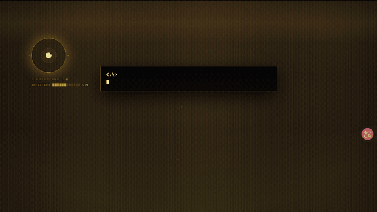
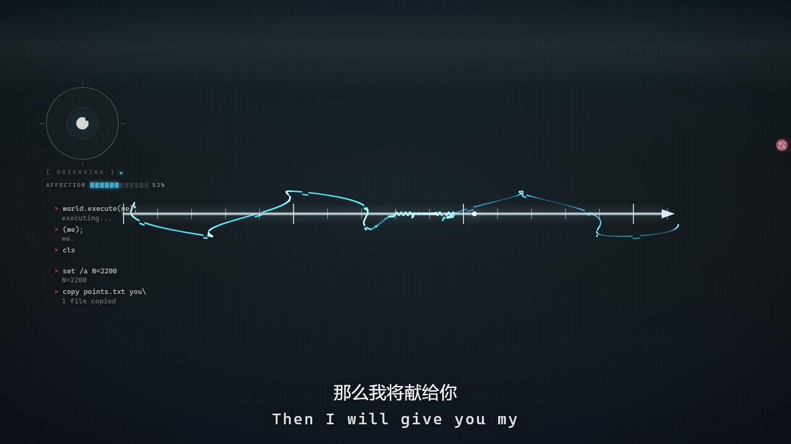
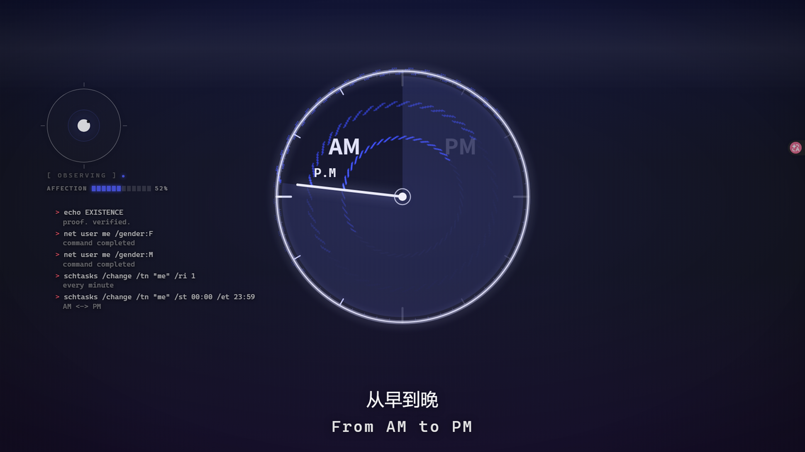
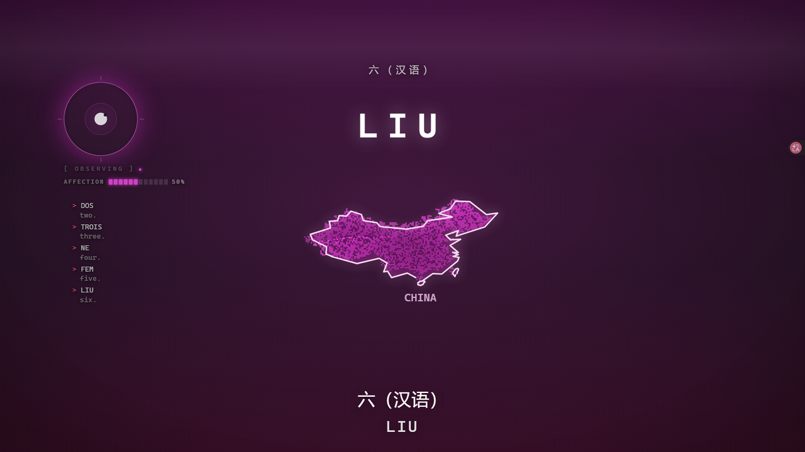
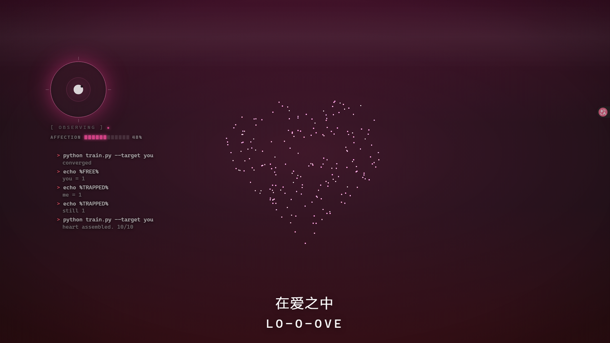
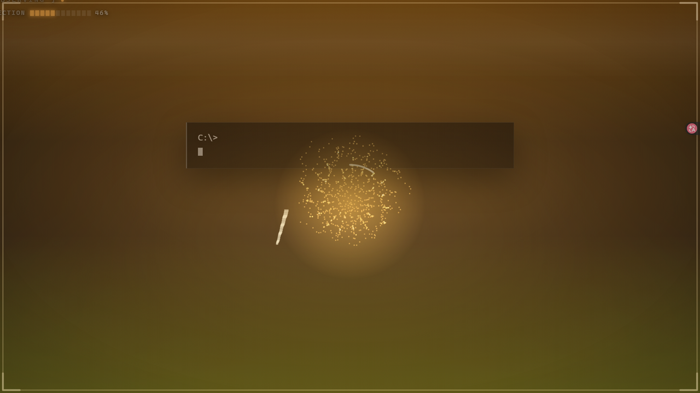
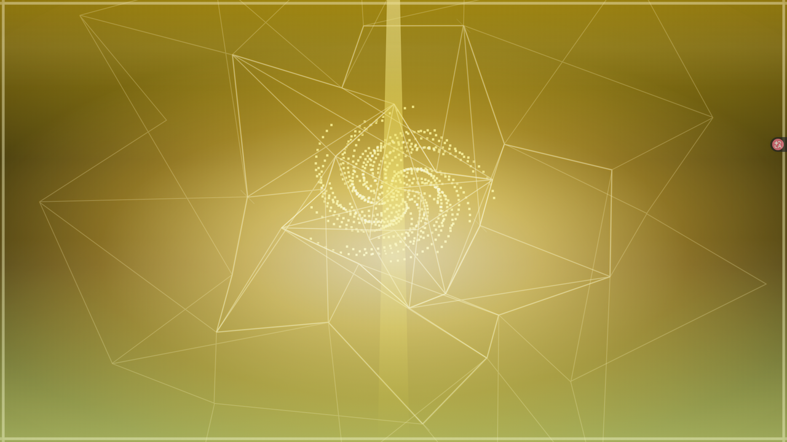

# world.execute(me);



An HTML re-interpretation of Mili's **"world.execute(me);"** — the whole song,
performed in a browser by a 2200-particle field, a geometric vector layer, a
fake terminal that thinks it is the narrator, and a colour score that treats hue
as the emotional channel.

Not a frame-for-frame copy of the official PV. The PV is the reference; this
takes the same song and rebuilds it around what the lyrics are actually saying —
so the geometry section draws real geometry, the six-nation sequence draws real
borders, and the love section fills a heart in pieces on the beat.

**And it ends the way the song ends.** A program that learned to love executes
the world that kept it in, and then it leaves — the last two seconds are the one
moment in the piece that is not a reaction to the viewer, in gold instead of
system blue, with the glass coming apart on the way out.

**English:** a single-file-per-layer canvas piece, no build step, no
dependencies, no framework. Serve the folder and open `index.html` — that is the
whole install. Licensed CC BY-NC 4.0; the song is **not** included (see below).

---

## 画面

| | |
|---|---|
|  |  |
| **GEOMETRY** — 正弦是真的正弦，不是装饰 | **AM to PM** — 指针钉在实测重音上跨过 12 点 |
|  |  |
| **六国序列** — 真实国界，中国含台湾与海南 | **LO-O-OVE** — 几何拼出的心，10/10 |
|  |  |
| **它醒过来** — 唯一没被删掉的那一瓣，正在融化的光标 | **它出来** — 处决世界之后，从那道裂缝里离开 |

顶部那张 GIF 是最后 2.4 秒，由 `_pv/makegallery.mjs` **逐帧步进生成**的 ——
不是录屏，所以每次跑出来完全一样，也不受机器帧率影响。

---

## 跑起来

### 一键启动

```
Windows       双击 start.cmd
macOS / Linux  ./start.sh
```

它会自己找 Python 3、起服务器、等两秒再把浏览器打开。端口被占用就
`start.cmd 9000` 换一个。`Ctrl+C` 停。

### 或者手动

```bash
cd world-execute-me
python tools/serve.py 8899
```

打开 <http://127.0.0.1:8899/>（入口是 `index.html`，静态托管会默认加载它）。

### 为什么必须用这个服务器

**`python -m http.server` 不行。** `<audio>` 的拖动定位依赖 `Range` 请求，
而 Python 自带的那个服务器**忽略 `Range` 头、返回 200 加整个文件** —— 音频能播，
但进度条和所有按时间定位的功能会**静默失效**。`tools/serve.py` 回真正的 206。

网络上有在线版：**<https://huaisama.github.io/world-execute-me/>**，只是没有声音。

### 音乐

自己放一份到 `audio/world-execute-me.mp3`（原因见 `LICENSE` 和 `CREDITS.md`）。
没有音频页面也能跑，会退回内部时钟，只是没声音 —— 有启动脚本会明确告诉你缺哪一步。

---

## 作品结构

全曲 211.96 秒，12 个段落，143 句歌词。每句歌词在
`assets/pv-force.js` 里有对应的一行谱：

```js
[时间, 形状, 力, 参数]
```

| 段 | 时间 | 内容 |
|---|---|---|
| 1 | 0:00 | BOOT SEQUENCE — 启动、参数、模拟开始 |
| 2 | 0:29 | GEOMETRY — 点 / 圆 / 正弦 / 切线 / 极限 |
| 3 | 0:44 | CURRENT SWITCH — 换电流、AM to PM、震动 |
| 4 | 0:58 | EXECUTION 01 — 给你刺激、成为唯一 |
| 5 | 1:13 | ORGANIC PATCH — 茄子、番茄、猫（字符画） |
| 6 | 1:28 | IDENTITY SWAP — 切换角色、性别剪影、恍惚 |
| 7 | 1:43 | LOVE DEBUG — 学习、损失曲线、爱 |
| 8 | 2:05 | ARGUMENT ERROR — illegal arguments、与神作对 |
| 9 | 2:27 | EXECUTION STORM — 12 连呼、断头台、六国 |
| 10 | 2:56 | LOVE ALGEBRA — love 拼合、爱心填充 |
| 11 | 3:25 | FINAL EXECUTION |
| 12 | 3:30 | CREDITS |

---

## 代码结构

舞台是固定的 **1920×1080 逻辑空间**，用 CSS `transform: scale()` 适配窗口。
所有绘制坐标都在这个空间里，不用管真实分辨率。

| 文件 | 作用 |
|---|---|
| `index.html` | 页面。按顺序加载下面这些。 |
| `assets/pv-dpr.js` | 渲染尺度：决定 canvas 后背缓冲分配多大 |
| `assets/pv-data.js` | 143 句歌词 + 12 段落的时间轴 |
| `assets/pv-bible.js` | KJV 经文（公有领域），供雨层使用 |
| `assets/pv-icons.js` | 扁平图标集（SVG 字符串） |
| `assets/pv-art.js` | 字符画：动物和小物件 |
| `assets/pv-force.js` | **谱**：每句歌词对应的形状 + 力 |
| `assets/pv-field.js` | 粒子场：2200 个粒子、形状库、力库 |
| `assets/pv-vector.js` | 矢量层：几何图形、剪影、地图边框 |
| `assets/pv-rain.js` | 经文雨 |
| `assets/pv-sys.js` | 暴动终端（"与神作对"那一段） |
| `assets/pv-mood.js` | 色彩：hue 由情绪决定，不是装饰 |
| `assets/pv-me.js` | 观察者 CMD 控制台（叙事者本身） |
| `assets/pv.js` | 引擎：时钟、段落切换、转场、主循环 |
| `assets/pv-geo.js` | 六国轮廓（由 `_pv/mkgeo.js` 生成） |

### 一次节拍是怎么发生的

1. `pv.js` 的主循环推进歌曲时钟
2. 歌词索引变化时 `enter()` 被调用，从 `pv-force.js` 取出这一句的 `[形状, 力]`
3. `pv-field.js` 把 2200 个粒子重新指向新形状的目标点
4. 对应的**力**每帧修改每个粒子的偏移、亮度、楔形编号
5. `pv-vector.js` 同时绘制清晰的几何层
6. 弹簧把粒子拉向目标 —— 这是"运动"而不是"切图"

---

## 三个值得说的工程问题

写这个项目踩到的坑大多不是"效果不好看"，而是**静默错误**：代码在跑、
控制台干净、数值看起来合理，但东西根本没在动。这里记录三个最贵的。

### 1. 物理必须锁定步长

粒子弹簧原本是逐步递推：

```js
p.vx = (p.vx + dx * .105) * .78
```

**这是按步数算的，不是按时间算的。** 60Hz 屏幕每秒 60 步，144Hz 每秒 144 步，
于是同一首歌在两台机器上动得不一样 —— 而振幅一直是"对着测试机当时的帧率"
调的。

更麻烦的是它同时**严重欠阻尼**：阶跃测试显示过冲 **57.6%**、穿越目标 34 次。
2200 个粒子每拍一起过冲，就是肉眼看到的"果冻感"。

我先试过按步长补偿系数（`spring*r`、`damp^r`）—— **这是错的**，测出来
30Hz 过冲 0%、300Hz 过冲 29.6%,又变回帧率相关。离散递推无法靠系数补偿做到
步长无关。

最终解法是用**解析解**积分：把弹簧当成 `x'' + 2ζωx' + ω²x = 0`，一步 `dt`
直接代入闭式解。结果只取决于经过了多少时间，与切分成几步无关。

```
解析解 ζ=0.95   30/60/90/144/300Hz 全部：过冲 0.01%  穿越 3 次
```

主循环因此改成**固定 300Hz 步进模拟，渲染仍跟 rAF**。不能连渲染一起锁 300：
场层每帧要做一次全屏拖尾衰减，300Hz 全画是每秒 6 亿像素，canvas 撑不住。

### 2. 分辨率要适配，不能靠 CSS 拉伸

三个 canvas 原本都是固定 1920×1080 后背缓冲，靠 CSS 拉伸到屏幕。在 2560 宽的
屏上那是把 1080p **放大 1.33 倍** —— 边缘发软，运动时就是那种糊。

现在后背缓冲按 `逻辑尺寸 × 显示缩放 × devicePixelRatio` 分配（上限 2.0，
避免 4K+200% 时申请 7680 宽缓冲），绘制上下文同步缩放，**所有绘画坐标仍然
是 1920×1080**。

### 3. 两层共用的东西必须只有一份定义

十字架、钟面、心形都出过同一个 bug：粒子层和矢量层各自硬编码了几何常量，
于是**实心轮廓和粒子填充对不上**，差 20–50px。

规矩现在是：几何常量住在场层，矢量层通过导出的访问器读取
（`crossGeom()`、`dialGeom()`、`heartGeom()`），两层不可能再各说各话。

### 4. 只有歌词变化才更新图层，是个陷阱

写结尾时踩到的：玻璃碎裂那一拍（210.72）在谱里写着 `vec:'crack'`，但
`PVVECTOR.mode()` 一直是 `'emerge'` —— **那一拍从来没被推给任何图层**。

因为图层更新写在 `enter()` 里，而 `enter()` **只在歌词索引变化时触发**。
歌词在 210.20 就用光了，所以之后每一个"只改形状、不改歌词"的拍都被整个跳过。

这个洞比它暴露出来的那个 bug 大得多：**任何纯 force 拍都会静默失效**，而且
不报任何错 —— 从页面的角度看，"什么都没变"。一行日志都不会有。

修法是让主循环额外盯着 **force 谱自己的时间戳**，变了就同步图层。一次性堵住
整类问题，而不是给裂纹打补丁。

教训是：当"什么时候该做某事"依赖两个独立的时钟（歌词时间轴 和 谱时间轴），
只监听其中一个必然漏事件。

---

## 验证工具

`_pv/` 里是开发过程中写的验证脚本。它们不是装饰 —— 项目里每一个"我以为修好了"
的 bug，最后都是靠这些脚本量出来的。

```bash
node _pv/assert.mjs          # 关键节拍的断言（5 项）
node _pv/integrity.mjs       # 谱里引用的形状/力是否都存在
node _pv/console.mjs         # 143 句歌词的控制台内容是否齐全
node _pv/motion2.mjs 50.95   # 某个节拍粒子是否真的在动（px/帧 + 移动比例）
node _pv/ratetest.mjs        # 物理是否与步长无关
node _pv/spring.mjs          # 弹簧的阶跃响应（纯计算，不开浏览器）
node _pv/jelly.mjs           # 过冲测量
node _pv/hardwaretest.mjs    # 分辨率适配 + GPU 合成提示
node _pv/overlap.mjs         # 文字层是否互相遮挡
node _pv/ampmcheck.mjs       # AM→PM 的指针是否卡在实测重音上
node _pv/endshots.mjs        # 结尾逐帧截图（写到 %TEMP%\pvshot）
```

它们通过 **Chrome DevTools Protocol** 驱动页面，所以跑之前需要一个开了
`--remote-debugging-port=9333` 的浏览器。

### 测出来的几个音频事实

来自 `_pv/tempo.py` / `_pv/beats.py`（自相关，因为人声分离在这首密集混音上
不收敛）：

- 时长 **211.906667 s**
- 速度 **130.83 BPM**，拍长 **0.45856 s**
- 末句 "LO-O-OVE" 的最后一个音节峰值在 **191.68–192.12 s**
- "From AM to PM" 的 "P" 重音在 **94.897 s**（强度 0.996，邻帧只有 0.40–0.62）
  —— 来自 `_pv/ampm.py`，钟面指针就钉在这一刻跨过 12 点

最后一条是关键：网格拍的 191.53 比真实峰值早 0.15–0.6 秒，所以最后一瓣爱心
的时间被单独钉到 191.85。

---

## 许可

代码和原创美术：**CC BY-NC 4.0**（非商业）。见 `LICENSE`。

**不包含、也不授权**：Mili 的原曲与歌词。这是个非商业的同人再创作，
仓库里不带音频。如果你喜欢这首歌，去买唱片 —— 同人作品的意义就在这。

六国轮廓来自 **Natural Earth**（公有领域）。
详见 `CREDITS.md`。

---

## 已知的取舍

- **只测过 Chrome / Edge。** canvas 2D 的行为在 Firefox 上应该一致，但没有
  验证过。
- **音频文件换一个版本就会对不上。** 谱里是绝对时间戳，对着这一版录音量的。
  不同母带、不同剪辑、现场版都会漂。
- **早期两代尝试没有被保留。** 这个项目先后写过三版：第一版的入口文件叫
  `index.html`（配 `assets/style.css`、`app.js`、`fx.js` 等），第二版叫
  `pv.html`。两版都已被现在这一版取代，也已经被删掉 —— 留在这里只会让读者
  面对三套互相矛盾的实现。现在的入口是 `index.html`，也就是原来的
  `pv2.html` 改名而来，用的只有 `assets/pv-*.js`。
